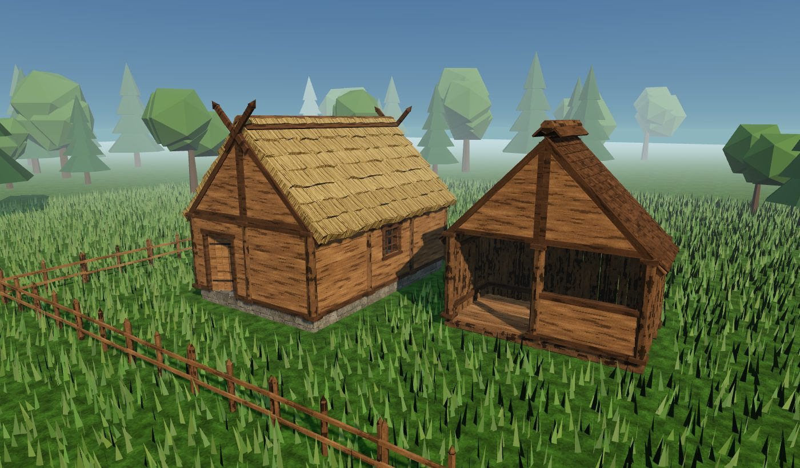
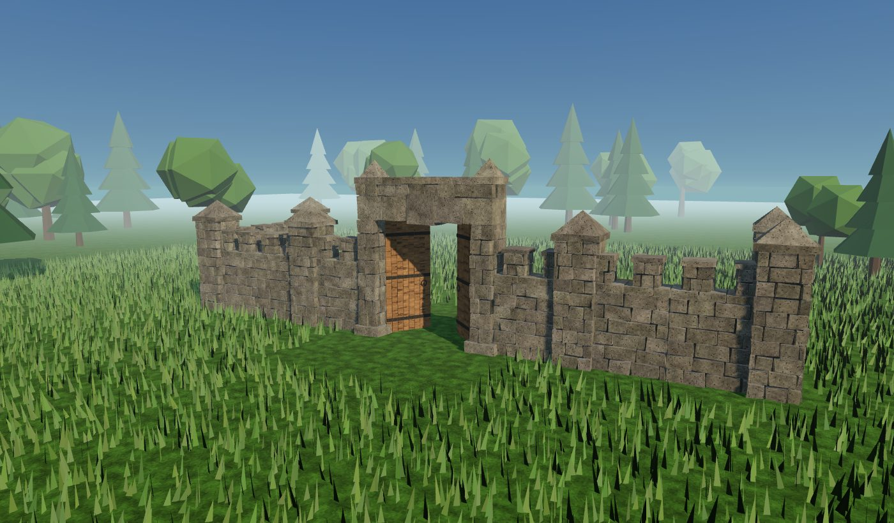
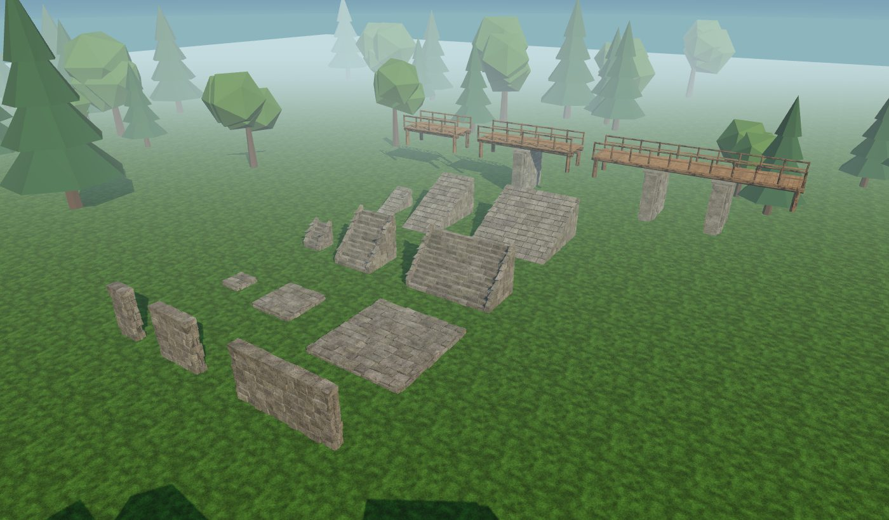
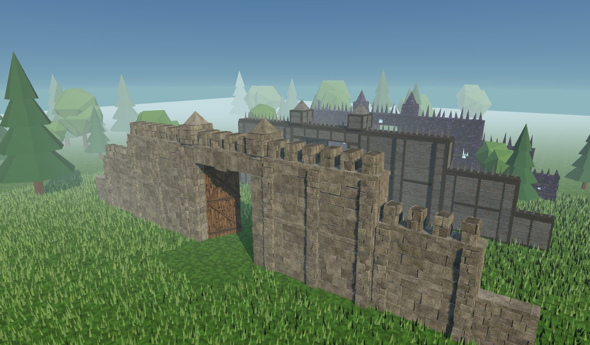

# Construção Low-Poly (estilo nórdico)

Kit de peças modulares para construção — no esquema do ARK (fundação, parede, teto, batente, telhado...)
mas com visual low-poly nórdico, texturas pixeladas e madeira rústica.

## Como usar

- **Arquivos prontos:** pasta [`modelos/`](modelos) — um `.glb` por peça, mais `kit_construcao.glb` (todas juntas), `casa_exemplo.glb`, `muralha_exemplo.glb`, `mostruario_pmg.glb` e `muralhas_niveis.glb`.
- **Materiais de cada peça:** [`CUSTOS.md`](CUSTOS.md) (para ler) e [`custos.json`](custos.json) (para o jogo ler). O custo também vai dentro de cada `.glb`, em `extras.custo`.
- **Editor no navegador:** abra `index.html` (precisa de internet para carregar o three.js). Dá para girar a câmera, ver cada peça,
  trocar o tom da madeira, gerar variações e baixar os `.glb`.
- **Gerar tudo de novo:** `node exportar.mjs` (precisa do `playwright`). Cria `modelos/` e `previas/`.

## Grade e medidas

Tudo em **metros**. Módulo de **3 × 3 m**, paredes de **3 m** de altura, telhado a **45°**.

| Peça | Arquivo | Origem (ponto de encaixe) |
|---|---|---|
| Fundação de pedra / madeira | `fundacao_pedra.glb`, `fundacao_madeira.glb` | centro do topo (o chão fica em y = 0) |
| Fundação triangular | `fundacao_triangular.glb` | meio da aresta de base |
| Parede de tábuas / troncos / janela / batente | `parede_*.glb`, `batente_porta.glb` | centro da base; lado de fora = +Z |
| Meia parede | `meia_parede.glb` | centro da base |
| Porta | `porta.glb` | dobradiça (canto de baixo); vão do batente = 1,5 × 2,29 m |
| Parede triangular (empena) | `parede_triangular.glb` | canto baixo; gire 180° para o outro lado |
| Teto / piso | `teto_madeira.glb` | centro de baixo (apoia no topo da parede) |
| Telhado de palha / tabuinhas | `telhado_palha.glb`, `telhado_tabuinhas.glb` | centro do módulo, altura do topo da parede; beiral = +Z |
| Cumeeira, ornamento | `cumeeira.glb`, `ornamento_empena.glb` | ponto mais alto do telhado |
| Pilar, viga, escada, cerca | `pilar.glb`, `viga.glb`, `escada.glb`, `cerca.glb` | base / centro |
| Muro de pedra (3 × 3 m, 0,9 m de espessura) | `muro_pedra.glb` | centro da base |
| Ameias (topo do muro) | `muro_ameias.glb` | centro da base; vai em y = 3, em cima do muro |
| Torre de canto (1,4 × 1,4 × 5,3 m) | `torre_pedra.glb` | centro da base; nas pontas e quinas do muro |
| Portal grande de pedra (6 × 6,6 m, vão 4,2 × 4,8 m) | `portal_pedra.glb` | centro da base, no meio do vão |
| Portão grande (duas folhas de 2,08 × 4,76 m) | `portao_grande_esq.glb`, `portao_grande_dir.glb` | dobradiça; esquerda em x = −2,1 e direita em x = +2,1 do portal |

Exemplo de encaixe: fundação em `y = 0` → paredes em `y = 0` nas bordas (±1,5 m) → telhado e empena em `y = 3`
→ cumeeira em `y = 6`.

Muralha: portal no meio, muros a cada 3 m a partir de ±4,5 m, ameias em cima (`y = 3`) e torres nas pontas.
As folhas do portão giram em Y na dobradiça (abrir = girar até ~90°).

## Peças em 3 tamanhos (P / M / G)

| Família | P | M | G | Origem |
|---|---|---|---|---|
| Parede de pedra (`parede_pedra_*`) | 1,5 × 3 m | 3 × 3 m | 6 × 3 m | centro da base |
| Piso de pedra (`piso_pedra_*`), 0,3 m | 1,5 × 1,5 m | 3 × 3 m | 6 × 6 m | centro de baixo (apoia no topo da parede) |
| Escada de pedra (`escada_pedra_*`) | 1,5 larg., sobe 1,5 | 3 larg., sobe 3 | 6 larg., sobe 3 | centro da base; sobe para −Z |
| Rampa de pedra (`rampa_pedra_*`) | 1,5 × 3, sobe 1,5 | 3 × 6, sobe 3 | 6 × 6, sobe 3 | centro da base; sobe para −Z |
| Ponte (`ponte_*`), 3 m de largura | 6 m | 9 m, 1 pilar | 15 m, 2 pilares | centro do piso (y = 0); comprimento em X |

Os pilares das pontes descem 4,4 m abaixo do piso (para rio ou vale).

## Muros por nível (pedra → metal → obsidiana)

Cada nível tem muro **normal (3 × 3 m)**, **grande (6 × 6 m)** e **gigante (9 × 9 m)**, mais um **portal gigante**
(9 × 9 m, vão de 6,6 × 7,5 m para dinossauros grandes) com duas folhas de portão.

| Nível | Muros | Portal e portão gigantes |
|---|---|---|
| Pedra | `muro_pedra`, `muro_pedra_grande`, `muro_pedra_gigante` | `portal_pedra_gigante`, `portao_pedra_gigante_esq/_dir` (troncos com treliça) |
| Metal | `muro_metal`, `muro_metal_grande`, `muro_metal_gigante` | `portal_metal_gigante`, `portao_metal_gigante_esq/_dir` |
| Obsidiana | `muro_obsidiana`, `muro_obsidiana_grande`, `muro_obsidiana_gigante` | `portal_obsidiana_gigante`, `portao_obsidiana_gigante_esq/_dir` |

Muros: origem no centro da base. Portal: centro da base no meio do vão. Folhas: dobradiça em x = ∓3,3 m do portal.

## Materiais

O custo de cada peça usa os recursos do jogo e sai do volume real de cada parte do modelo
(peça maior custa mais):

| Parte do modelo | Recurso | 1 unidade vale |
|---|---|---|
| tábuas, vigas e troncos | Madeira | 0,04 m³ |
| palha do telhado | Palha + Graveto + Fibra | 0,25 / 0,5 / 0,5 m³ |
| pedras aparentes | Pedra | 0,15 m³ |
| argamassa (miolo das peças de pedra) | Pasta de Cimento | 1 m³ |
| ferragens (faixas, argolas, pinos) | Lingote de Metal | 0,0025 m³ |
| chapas de metal | Lingote de Metal | 0,02 m³ |
| blocos de obsidiana | Obsidiana | 0,12 m³ |
| cristais brilhantes | Cristal | 0,002 m³ |

Para balancear, mude os números de `fontes` em `RECURSOS` no `index.html` e rode `node exportar.mjs` de novo.
Tabela completa em [`CUSTOS.md`](CUSTOS.md).

## Importar na engine

- **Godot 4:** arraste o `.glb` para o projeto.
- **Unity:** instale o pacote **glTFast** (Package Manager → `com.unity.cloud.gltfast`) e arraste o `.glb`.
- **Unreal 5:** Import → `.glb` (plugin glTF Importer vem ativado).
- **Blender:** File → Import → glTF 2.0.

Cada peça usa poucos materiais compartilhados (`madeira`, `madeira_escura`, `tronco`, `palha`, `pedra`, `ferro`),
textura 64×64 com filtro *point/nearest* e **cor por vértice** (a variação de tom entre tábuas).
Se a madeira ficar toda igual na engine, ative o uso de *vertex color* no material.

O visual "Valheim" completo também depende da engine: neblina, luz quente de fim de tarde, sombras suaves e grama balançando.
